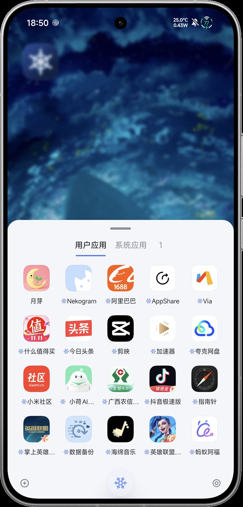
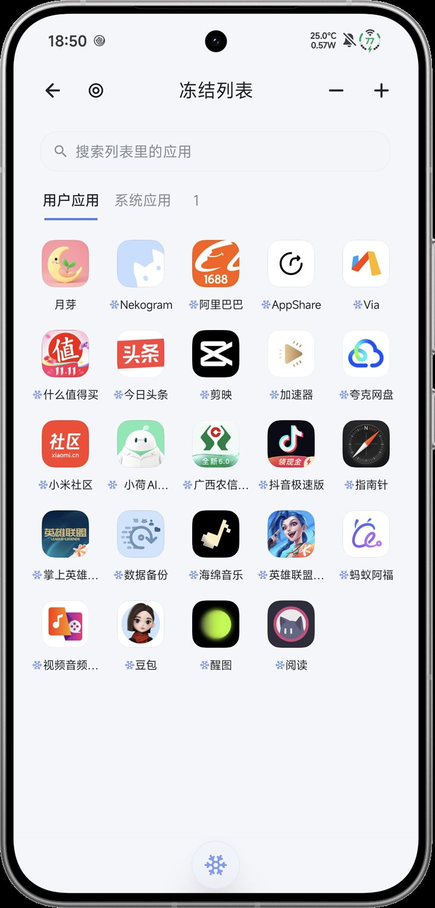
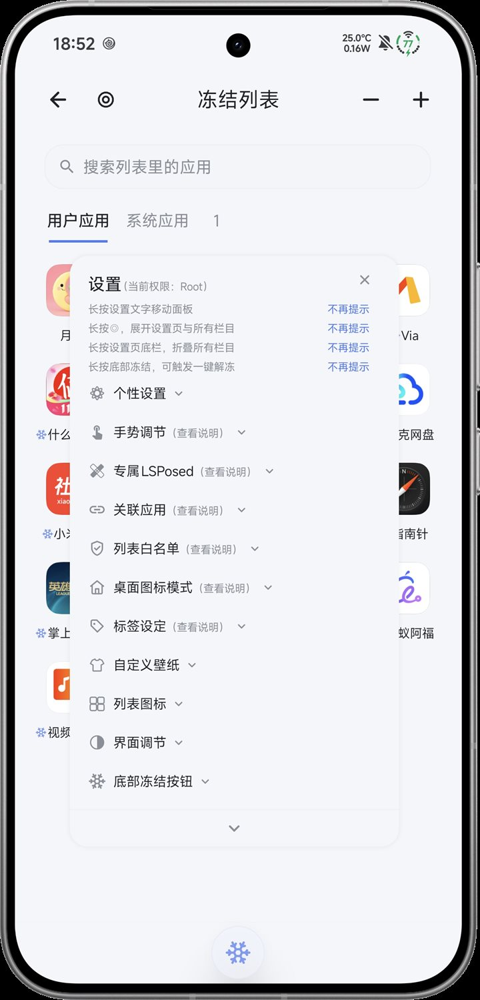
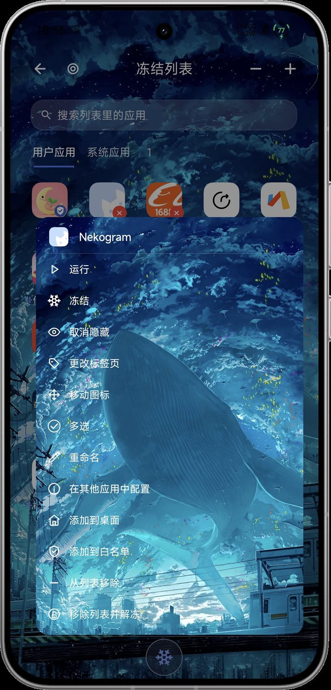
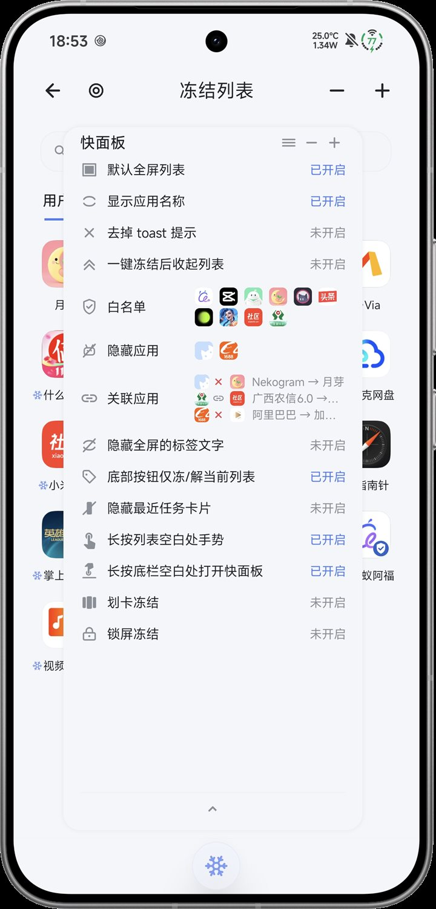
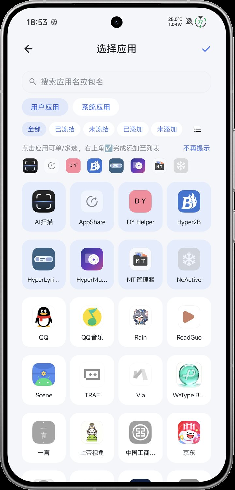

# 凚（Jin）

集百家之长，合凚之美；  
做最人性化的应用冻结工具。  
名单里的应用可冻结 / 隐藏 / 解冻 / 取消隐藏，也能在列表内直接启动；  
冻结后无法在后台运行，隐藏后如同没安装。支持半屏面板与全屏列表两种形态。

> 包名：`com.jin.freeze`　最低系统：Android 7.0（minSdk 24）　目标：Android 14（targetSdk 34）

## 前言

使用前提：需要 Root、Shizuku 或 Dhizuku 授权；应用本身不联网

## 功能

**名单与冻结**
- 自定义名单：多标签、多选、拖动排序、重命名、宫格 / 列表视图，支持名称与拼音首字母搜索
- 双开与分身：自动识别多用户实例，冻结、隐藏、暂停、解冻、取消隐藏、取消暂停与启动都按实例处理
- 一键冻结 / 解冻：底部按钮冻住整份名单，长按按钮解冻；可限定只处理当前标签
- 多种权限通道：Root、Shizuku、Dhizuku（Device Owner）；停用失败时自动降级为系统「暂停」
- 白名单：加入白名单的应用无法被冻结 / 隐藏，除长按桌面图标与快捷方式的一键冻结外
- 关联应用：打开主应用静默解冻副应用，冻结主应用同步冻结副应用
- 桌面快捷方式：长按桌面图标可一键冻结 / 解冻，也可为任意应用添加桌面入口
- 保留桌面图标模式：冻结模式转为暂停模式，同时桌面图标保留并置灰，点击置灰图标可继续打开

**隐藏**
- 隐藏应用：需 Root / Dhizuku / Shizuku(root)，隐藏后如同未安装，仍可在列表启动或取消隐藏

**界面与手势**
- 两种形态：半屏浮层随手打开，全屏列表适合慢慢整理
- 长按手势：列表空白处左右滑切标签，上滑进全屏、下滑回半屏
- 快面板：长按底栏空白呼出，可自定义常用设置入口
- 半屏调节：拖动顶部小白条改高度
- 自定义壁纸：选图作底，可调缩放与位置、独立模糊度；半屏 / 全屏各存一份，可一键同步
- 界面定制：背景透明度与模糊度、字体、列数、图标大小、底部按钮位置与大小
- 图标：冻结图标支持全彩 / 全灰 / 八种半灰半彩，可跟随系统主题图标

**通道专属**
- 专属 LSPosed：划卡冻结、锁屏定时冻结、静默打开置灰图标、消除启动白底（HyperOS 4）；激活后无需常驻后台
- 专属 Shizuku：划卡冻结、锁屏定时冻结，凚被冻结或退出不影响服务

**数据**
- 备份与恢复：可分别恢复配置、冻结列表、白名单、关联应用、隐藏应用、桌面快捷方式
- 诊断包：长按关于凚的 Logo，导出本地诊断包，可交给开发者排查与修复问题

## 截图

| 半屏列表 | 全屏列表 |
| :---: | :---: |
|  |  |

| 设置页 | 自定义壁纸 |
| :---: | :---: |
|  |  |

| 快面板 | 选择应用 |
| :---: | :---: |
|  |  |

## 权限说明

| 权限 | 用途 |
| --- | --- |
| `QUERY_ALL_PACKAGES` | 列出本机全部应用，供加入冻结名单 |
| `VIBRATE` | 长按、排序等操作的震动反馈 |
| `REORDER_TASKS` | 列表与前台任务切换 |
| `MANAGE_EXTERNAL_STORAGE` | 读写 `Download/凚/备份` 下的备份文件 |
| `WRITE_EXTERNAL_STORAGE`（≤ Android 9） | 同上 |
| `com.android.launcher.permission.INSTALL_SHORTCUT`（≤ Android 7.1） | 旧桌面安装快捷方式 |

冻结 / 解冻本身不申请任何危险权限，全部通过 Root、Shizuku 或 Dhizuku 通道执行系统命令。

## 编译

环境：JDK 17、Android SDK（compileSdk 35）、Gradle 8.9。

```bash
# 调试版
./gradlew assembleDebug

# 发布版（R8 混淆 + 资源收缩）
./gradlew assembleRelease
```

Windows 下用 `gradlew.bat`。工程根目录的 `gradle.properties` 已关闭 AGP 的非 ASCII 路径检查，可放在中文路径下。

### 签名

`app/build.gradle` 的 release 构建默认使用 `signingConfigs.debug`，方便直接出包自测。
正式对外分发时请换成自己的签名：

```groovy
android {
    signingConfigs {
        release {
            storeFile file(System.getenv("JIN_KEYSTORE") ?: "release.jks")
            storePassword System.getenv("JIN_STORE_PASS")
            keyAlias System.getenv("JIN_KEY_ALIAS")
            keyPassword System.getenv("JIN_KEY_PASS")
        }
    }
    buildTypes {
        release { signingConfig signingConfigs.release }
    }
}
```

`*.jks` / `keystore.properties` / `local.properties` 已在 `.gitignore` 中排除。

## 目录结构

```
app/src/main/
├── java/com/jin/freeze/
│   ├── core/     # 权限通道、冻结/暂停/隐藏、备份、壁纸、拼音检索
│   ├── lite/     # Shizuku UserService（在 shell 进程里代执行 pm）
│   ├── ui/       # 半屏面板、全屏列表、设置页、长按选项框
│   └── xposed/   # LSPosed 模块：划卡冻结、锁屏冻结、灰色图标启动
├── aidl/         # IJinLite：主应用与 Shizuku 服务的跨进程接口
├── resources/META-INF/xposed/   # 模块元数据（module.prop / java_init.list / scope.list）
└── res/
framework-stubs/  # 编译期用的隐藏 API 桩（TaskStackListener），不打包进 APK
```

## 第三方依赖

见 [THIRD_PARTY_NOTICES.md](THIRD_PARTY_NOTICES.md)。`app/libs` 下的 jar 会随仓库一起提供，以保证克隆后可直接编译。

## 致谢与借鉴

本项目部分实现参考了以下项目，版权归各自作者所有：

- hyper2B（本人项目）
- 搞机助手（本人项目）
- 冰箱（IceBox）
- 雹（Hail）
- Thanox

## 免责声明

本项目会修改系统应用状态（停用 / 暂停 / 隐藏），存在导致系统异常或数据丢失的风险。
请自行评估后使用，作者不对任何直接或间接损失负责。冻结系统应用前请确认其作用。

## 许可证

Copyright (C) 2026 酷安@大火

本项目以 [GNU General Public License v3.0](LICENSE) 发布。
